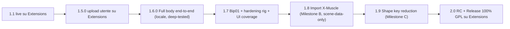

# FlexForge — Piano di aggiornamento 1.5 / 1.6 → 2.0

**Tesi della 2.0:** *"Da qualsiasi rig a muscoli game-ready in Godot/Unity con un click, 100% gratis (GPL-3.0-or-later) su Blender Extensions."*

Questo piano aggiorna la roadmap di `ROADMAP.md` integrando le decisioni confermate dall'utente il 2026-11-25:

1. **Pubblicazione Extensions:** la **1.1** è già pubblicata e approvata su Blender Extensions; la **1.5.0** verrà caricata dall'utente.
2. **Asset reali non disponibili al momento:** non sono disponibili né un rig Bip01 reale né un file `.blend` reale di X-Muscle; le fasi 1.7 e 1.8 sono quindi progettate in modo *de-risked* tramite fixture sintetiche non degeneri, contratti dati documentati e fallback manuali.
3. **Distribuzione 2.0:** **100% gratis (GPL-3.0-or-later) su Blender Extensions** — nessuna versione commerciale, nessun piano Pro, nessuna vendita su Superhive o Gumroad.

> **Regola di avanzamento:** una fase alla volta. Si passa alla fase successiva solo con i gate verdi (suite completa su Blender 4.2.3 LTS e 5.2.0 LTS, `ALL_GATES_OK 4/4`, `blender --command extension validate`). Restano fuori perimetro: jiggle o VFX live in viewport, brush/pie menu weight paint, supporto Unreal.

## Percorso 1.5 → 2.0

## Fasi dettagliate

| Versione | Stato / Obiettivo | Consegna principale | Gate di uscita |
|---|---|---|---|
| **1.5.x** | **Pronta per upload utente** | La `1.1` è già approvata/live su Blender Extensions; l'utente carica `dist/flexforge-1.5.0.zip` (`ALL_GATES_OK 4/4`, 256/256 test) seguendo `docs/PUBLICATION_PLAN.md`. | Pagina pubblica aggiornata a `1.5.0`, primo feedback reale raccolto. |
| **1.6.0** | **Implementata & deep-tested in locale** | Flusso *Create full body* end-to-end in **un solo undo** (`flexforge/fullbody_pipeline.py` + `muscle_fullbody.py`): detection → helper → capsule skinning → bake shape key + driver → verifica deformazione → budget engine LOD-aware, con rollback su errore e warning su eccesso di budget. | Suite completa verde su Blender 4.2.3 e 5.2.0, `ALL_GATES_OK 4/4`, `extension validate`, E2E Godot 4.7.2 `FULLBODY_GODOT_E2E_OK`. |
| **1.7** | **Bip01 + hardening rig + UI coverage** *(de-risked)* | 1) Fixture sintetica Bip01 **non degenere** (teste/code distinte per compatibilità Blender 4.2.3 Edit Mode) + rig Bip01 CC0/utente se disponibile in seguito. 2) **UI coverage report** nel pannello (preset trovati vs mancanti e motivo). 3) **Manual bone picker fallback** per mappare ossa fuori alias direttamente dalla Sidebar. | `detect_rig` 9/9 su Mixamo, ARP, Rigify e fixture Bip01; report copertura visibile in UI; test di regressione su 4.2.3 e 5.2.0. |
| **1.8** | **Milestone B — Lettore X-Muscle (solo dati di scena)** *(de-risked)* | 1) **Contratto dati aperto documentato** (custom properties, vincoli, naming per coppie flexor/extensor — zero codice X-Muscle nel repo). 2) Lettore puro + conversione in shape key guidate dalle ossa + export `.glb`. 3) Fallback manuale/JSON per mappature custom. 4) Test su scene sintetiche X-Muscle-like; verifica su `.blend` reale marcata come gate opzionale su campione fornito da utente/community. | Scene sintetiche convertite ed esportate con `ENGINE_CHECK_OK` (Godot); differenza di deformazione entro la tolleranza del benchmark; gate `.blend` reale aperto fino a disponibilità campione. |
| **1.9** | **Milestone C — Riduzione intelligente shape key** | Estensione di `engine_budget.py`: riduzione intelligente delle shape key per utilizzo/contributo di deformazione e per budget VRAM in Godot (non più semplice troncamento per ordine). | Golden scene con budget rispettato e deformazione entro la soglia; benchmark 13/13 verdi. |
| **2.0** | **RC + Release 100% GPL** | Release Candidate (1–2 settimane) su Blender Extensions, raccolta e fix feedback, pubblicazione finale **100% gratuita (GPL-3.0-or-later)** su Blender Extensions + annuncio Blender Artists / Reddit + showcase (Milestone D). | Suite completa verde su 4.2.3 e 5.2.0, CI 5/5 verde, `extension validate` exit 0, zero bug bloccanti dalla RC. |

## Mitigazione rischi (asset reali mancanti)

- **Assenza rig Bip01 reale (1.7):** si usa una fixture sintetica Bip01 geometricamente valida (ossa non coincidenti, gerarchia `Bip01 Pelvis` → `Bip01 Spine` → `Bip01 L Clavicle` / `UpperArm` / `Forearm` / `Thigh` / `Calf` / `Foot`) più il *manual bone picker* in UI, così qualsiasi rig reale non standard resta utilizzabile senza bloccare il rilascio.
- **Assenza `.blend` X-Muscle reale (1.8):** il lettore si basa su un contratto dati di scena documentato e su un fallback JSON/manuale; la validazione su scene sintetiche verifica la pipeline end-to-end, mentre la conferma su file `.blend` reale resta esplicitamente segnalata come gate community/utente.
- **Crescita regressioni:** ogni bug trovato (es. gestione rig asimmetrici `.L`, warning budget multi-mesh, rollback selettivo) viene fissato con un test dedicato in `tests/test_*.py` eseguito sia su Blender 4.2.3 sia su 5.2.0.
